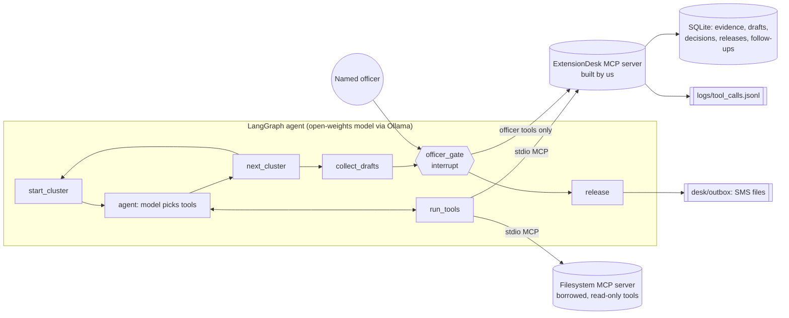

# Architecture

## Agent shape

A small LangGraph state machine, run one cluster at a time so a local 8B model keeps a short context. For each cluster the model loops between thinking and tool calls (up to 14 steps) until it has drafted its advisories. Then the graph collects the pending drafts and stops at `officer_gate`, which calls `interrupt()` once per draft. The run resumes only when a person types a name and a decision. `release` then writes approved drafts to the outbox.

The model never computes rainfall statistics and never holds an irreversible tool. Numbers and rule verdicts come from deterministic code (`rainfall.py`, thresholds in `rules.yaml`). The model's job is the part that needs judgement: reading the evidence, deciding which advisories a cluster needs, writing a plain SMS, citing sources, reacting to server rejections and officer notes, and scheduling follow-ups.

## MCP servers

**Built: ExtensionDesk server** (`server.py`, FastMCP, stdio).

| Tool | Who calls it | Kind |
|---|---|---|
| `list_clusters`, `get_cluster_profile`, `get_rainfall_signal`, `get_pest_alerts` | model | read; each records the source IDs it returns in the evidence table |
| `draft_advisory` | model | **acts**: validates sources, rule agreement, crop window and zone; saves a PENDING draft |
| `schedule_follow_up` | model | **acts**: creates a sourced visit or call task |
| `list_drafts` | graph | read |
| `officer_record_decision` | graph, after `interrupt()` | **acts, gated**: needs a named officer |
| `release_advisory` | graph | **acts, irreversible, gated**: refuses anything not approved |

Why build it: the value of this tool is the rules it enforces (sourcing, agreement with the rainfall verdict, crop windows, approval before release). No existing server knows an extension desk's rules, and one that only proxied a rainfall API would not stop a bad advisory.

**Borrowed: official MCP Filesystem server** (`@modelcontextprotocol/server-filesystem`), scoped to `desk/officer_notes/`, with only `list_directory` and `read_text_file` exposed to the model.

Why borrow it: officers already keep notes as files, and a maintained, sandboxed file server with path checks beats writing our own file access, which would add risk and no value.

## Where the data goes

Everything runs on the officer's machine: the model (Ollama), both MCP servers, the database and the log. No household record leaves the device, which matters because household and yield records may not be allowed to leave the country. A hosted model can be swapped in through an OpenAI-compatible URL for comparison, on synthetic data only.

## Designed for change

Thresholds live in `rules.yaml`. A new signal is one new `@mcp.tool()` function plus one line in `AGENT_TOOLS`. A new hard rule is a few lines in `draft_advisory`'s validation. Officer-only tools are listed in `OFFICER_TOOLS` and never reach the model.
